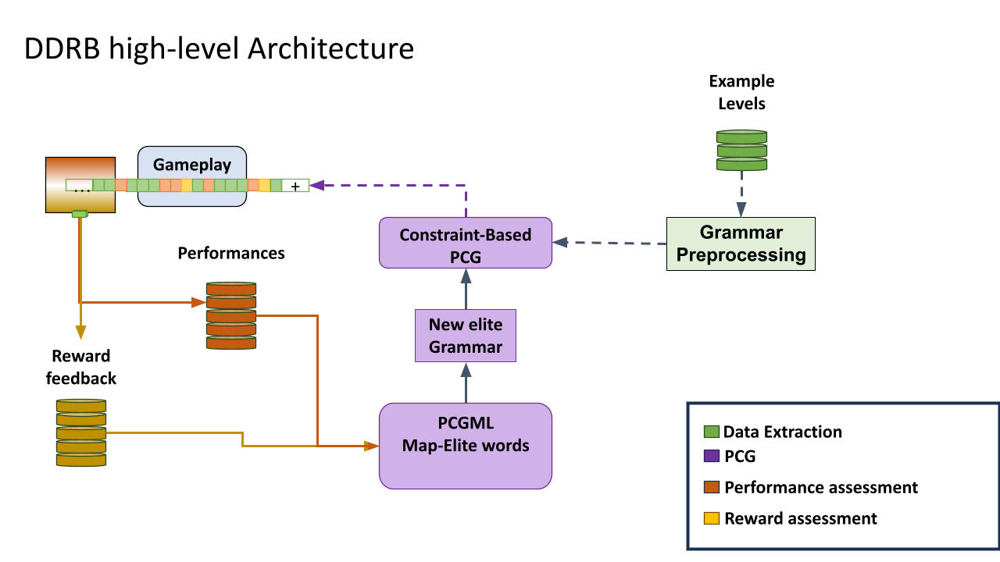
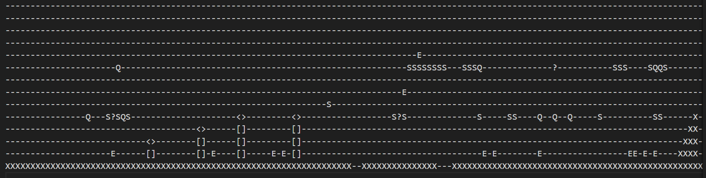
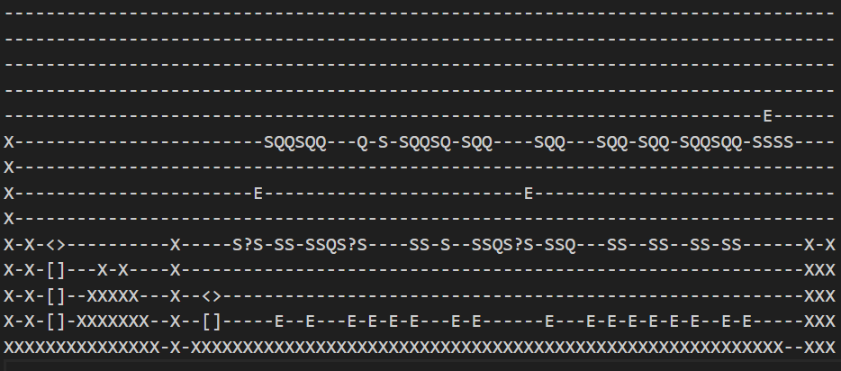

# Level Up: Dinamic Difficulty-Reward Balancing 
A research about learning optimization on the AI Super Mario Bros. Framework.

## Abstract

Difficulty adjustment is a core design decision in games and education alike. The video game industry has studied how to balance difficulty to maintain player engagement for decades, leading to a specialized field focused on automatic adjustment: Dynamic Difficulty Adjustment (DDA). Although DDA is extensively studied in games, it originated in cognitive science as Csikszentmihalyi's flow theory (1970). However, the transition from flow theory to DDA has lost both applicability to other contexts (such as education) and explicit consideration of factors beyond difficulty that are equally relevant to dynamic adjustment.

This project reconceptualizes DDA as an abstract learning problem grounded in flow theory, proposing it as a new paradigm for AI-supported educational systems. Specifically, we present a Dynamic Difficulty-Reward Balancing (DDRB) pipeline that encourages flow-theoretic conditions and extends automatic adjustment to consider both task challenge and environmental economy. By doing so, the dynamic balancing system implicitly addresses more complex aspects of frustration and boredom, moving beyond binary task feasibility to evaluate whether a task is worthwhile in the learner's context.

As an initial experiment, we use the Super Mario Bros framework (a widely studied computational benchmark) reframing it not as an engaging game but as a learning task with an optimal learning curve. Rather than training from human gameplay, which would be prohibitively ambitious, we leverage the extensive literature on SMB agents to train and test our model. Our core hypothesis is that DDRB improves agent robustness and convergence compared to existing methods. We additionally hypothesize that agent behavior provides sufficient diversity to correlate with human learning experience.

## Research Question

Can Dynamic Difficulty Reward Balancing (DDRB) improve agent robustness and convergence in Super Mario Bros training compared to fixed-level training and equivalent PCGML baselines without difficulty-reward balancing?

### Subsequent Questions

- System generates "Fun/Learning optimal" levels for human players?
- This hipotetical behavior could be translateble to other ML kind problems as LLMs? 
- Can an LLM based DDRB architecture versus academic problems, on a especific subjects, destilate an human oriented AI tutor?

## Project Objectives

- Implement the five components of the SMB DDRB system: 

    1. **Raw Level Generator**: A PCG system using Feasibility Search with Solvability filtering and Diversity Map-Elites to generate candidate levels.
    2. **Difficulty Ranker**: Labeling levels by heuristic and deep learning predictors of agent performance in platform-based task.
    3. **Reward Dispatcher**: A deep learning model equipped with actions to mediate agent learning by managing environmental economy (coins, question boxes, goombas, etc.) in accordance with overall task objectives.
    4. **Agentic Player Sandbox**: A configurable environment for training DDRB-consistent agents to play Super Mario Bros.
    5. **System Manager**: Orchestrate the other DDRB components (1–3) to deliver near-optimal levels sequentially based on an agent's historical performance (from 4).

- Develop an evaluation workflow comparing training outcomes under the original SMB baseline with training under DDRB.

## Background
### Dynamic Difficulty Adjustment vs. Flow Theory
### Learning, Expertice and Reward
### Expirience-Driven PCG
### Super Mario Bros. Framework
### AI Agentic Players
### Mario PCG and Diversity on Learning
### Map Elites and Agents Performance

## Experimental Plan

System architecture is essencialy same as Expirience Driven PCG, which is also similar to world models. 

### Agents to Evaluate

- Heuristic agent from `mario_rl_env/run_agent.py`
- baseline agent trained on original Super Mario Bros levels
- DDRB-trained agent using validated generated levels
- non-DDRB PCGML agent trained on generated levels without reward balancing (comparison arm)

### Baselines

- fixed-level training on processed original levels in `Super_Mario_Brothers_Maps/Processed/`
- generated-level training with the same PCGML pipeline but without DDRB reward updates
- a structural difficulty adjustment baseline (if available) that modifies level layout instead of reward weights

### Metrics

Robustness:

- completion rate on held-out generated levels
- performance variance across Map-Elites niches
- transfer from original levels to generated level evaluation sets

Convergence:

- episodes required to reach a target average reward threshold
- training curve slope and stability over time
- final policy performance on both original and generated evaluation levels

Secondary metrics:

- feature-space coverage achieved by Map-Elites
- diversity of selected generated levels in landing/collider statistics

### Evaluation Protocol

- train each agent for a fixed budget of episodes
- evaluate on the same validated generated level set and on held-out original levels
- compare means and standard deviations across multiple random seeds
- measure both robustness and convergence improvements relative to baselines

## Methodology

### Level Representation Formats

This project uses three complementary representations:

- **Grammar token sequences** from `world_generation/Universal_Structures.txt` for structured construction and pattern reuse.
- **Tile-map encodings** for standard Super Mario Bros level geometry and agent observation states.
- **Compact integer vectors** that encode landing and collider attributes in discrete bit ranges for fast validity checks.

The compact integer encoding stores per-column attributes that are used by solvability and feature extraction routines in `world_generation/Word_Stitching.py` and `world_generation/Variety_Domains.py`.

### Solvability Validation Algorithm

Solvability filtering is implemented in `world_generation/Word_Stitching.py`.

Key components:

- `Punctual_Binary_Prop(n, k)` inspects a specific bit in a tile or column encoding.
- `Range_Binary_Prop(n, a, b)` reads a contiguous bit range for attribute extraction.
- `Jumping_Fiasible_Word(Level, knowledge)` determines if landing columns are reachable by feasible Mario jumps and walks.

Validation criteria:

- valid start and goal landing structures are present
- each landing column can be reached from a prior landing by the agent's movement constraints
- path feasibility is checked conservatively by requiring at least one valid path rather than exhaustive state enumeration

### Feature Functions for Map-Elites

Map-Elites diversity is managed using feature functions in `world_generation/Variety_Domains.py`.

Current features include:

- overworld, underground and athletic

These features embed levels into a bounded space and guide elite selection toward diverse, behaviorally distinct content.

### Reward-Balancing Mechanism

Dynamic Difficulty Reward Balancing (DDRB) adjusts reward weights across gameplay signals instead of directly modifying level difficulty.

The mechanism:

- tracks multiple reward components such as traversal success, enemy interaction, progression, and failure penalties
- updates component weights as training proceeds to encourage stable learning dynamics
- influences generation indirectly by selecting levels that match the desired reward profile during Map-Elites search

The `main.py` pipeline applies DDRB via the `Performance` payload and `variety_domains` settings, linking reward-driven generation with Map-Elites selection.

### Dataset and Source Levels

Source data is drawn from both original and generated assets:

- original levels in `Super_Mario_Brothers_Maps/Original/`
- processed training levels in `Super_Mario_Brothers_Maps/Processed/`
- grammar structure definitions in `world_generation/Universal_Structures.txt`
- generated candidate levels in `Super_Mario_Brothers_Maps/generated_levels/`

For evaluation, the primary training set is validated generated content, while the baseline set uses processed original levels.

### Generated Levels Validation

Generated candidates are validated in two stages:

1. grammar and token consistency is verified against the universal structure set.
2. playability is checked via `Jumping_Fiasible_Word` in `world_generation/Word_Stitching.py`.

Only levels passing both checks are used for DDRB training and evaluation.

### Prototype Pipeline

The prototype workflow in `main.py` demonstrates:

- creating a generation instance through the API
- requesting `Performance` generation with Map-Elites feature domains and grid points
- running a `tabular_q` agent over the validated generated level pool

This workflow supports direct comparison between DDRB training and baseline agents.

*Figure 1: DDRB architecture for PCGML generation, validation, and agent training.*

*Figure 2: Token and tile representation of Super Mario Bros level 1-1.*

*Figure 3: Example generated level selected by Map-Elites.*

## Results / Expected Outcomes

Preliminary implementation indicates the DDRB pipeline is operational and that generated levels are filterable with the current solvability heuristics.

Expected outcomes:

- stronger completion performance on generated evaluation levels than fixed-level baselines
- improved convergence speed for DDRB-trained agents compared to non-DDRB PCGML training
- broader Map-Elites feature coverage through validated generated level selection

The current repository supports an end-to-end prototype from generation request to agent rollout, providing a foundation for formal experiments.

## References

- `world_generation/Word_Stitching.py` — solvability validation via bitwise landing/collider analysis
- `world_generation/Variety_Domains.py` — Map-Elites feature functions
- `main.py` — DDRB pipeline orchestration and agent evaluation
- `mario_rl_env/run_agent.py` — tabular Q-learning agent implementation
